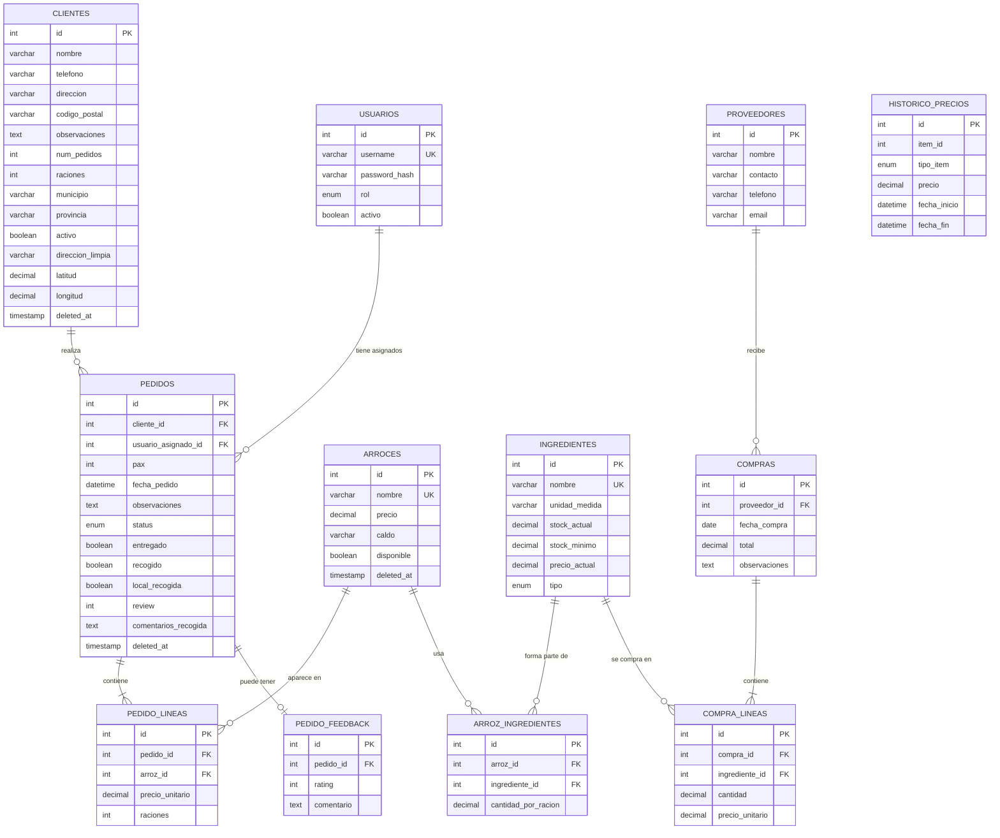

# Diagrama de relaciones - Arroces Llopis

Esquema obtenido de la base de datos MySQL configurada actualmente.

## Vista interactiva

Abre [`diagrama-bbdd.html`](../frontend/public/diagrama-bbdd.html) en el navegador o visita `/diagrama-bbdd.html` con el servidor de Vite iniciado.

## Relaciones

| Origen | Destino | Cardinalidad | Clave |
|---|---|---|---|
| clientes | pedidos | 1:N | `pedidos.cliente_id -> clientes.id` |
| usuarios | pedidos | 1:N opcional | `pedidos.usuario_asignado_id -> usuarios.id` |
| pedidos | pedido_lineas | 1:N | `pedido_lineas.pedido_id -> pedidos.id` |
| arroces | pedido_lineas | 1:N | `pedido_lineas.arroz_id -> arroces.id` |
| pedidos | pedido_feedback | 1:0/1 | `pedido_feedback.pedido_id -> pedidos.id` |
| arroces | arroz_ingredientes | 1:N | `arroz_ingredientes.arroz_id -> arroces.id` |
| ingredientes | arroz_ingredientes | 1:N | `arroz_ingredientes.ingrediente_id -> ingredientes.id` |
| proveedores | compras | 1:N | `compras.proveedor_id -> proveedores.id` |
| compras | compra_lineas | 1:N | `compra_lineas.compra_id -> compras.id` |
| ingredientes | compra_lineas | 1:N | `compra_lineas.ingrediente_id -> ingredientes.id` |

`historico_precios` no tiene claves foraneas: `item_id` identifica indirectamente un arroz o ingrediente segun `tipo_item`.

`pedido_feedback.pedido_id` es unico, por lo que cada pedido puede tener como mucho un registro de feedback.

La base de datos tambien contiene las vistas `vista_pedidos_detallados` y `vista_stock_critico`. Ambas son consultas derivadas y no crean relaciones fisicas adicionales.
